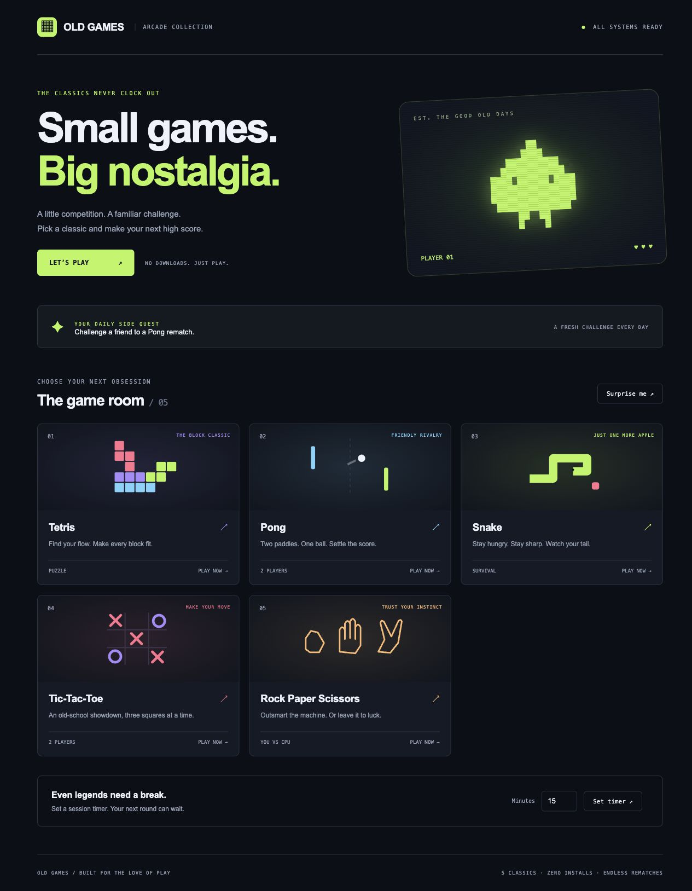
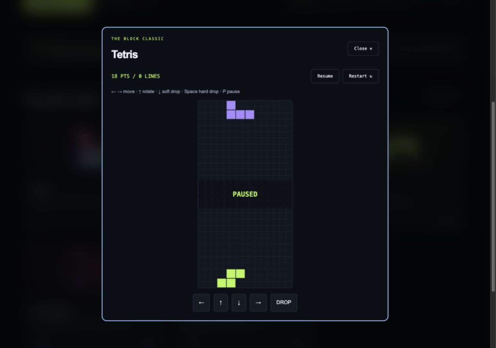

<div align="center">


# OLD GAMES

### Small games. Big nostalgia.

Five arcade classics, a polished Java desktop launcher, and a browser edition.<br>
No game dependencies. No accounts. Just one more round.


[](https://otharwat3.github.io/Old-Games/)
[](#run-the-desktop-app)



</div>

## The collection

| Game | Your mission | Controls |
| :--- | :--- | :--- |
| **Tetris** | Stack seven tetrominoes and clear lines. | ← → move · ↑ rotate · ↓ drop · browser: Space hard drop |
| **Pong** | A local two-player paddle showdown. Browser: first to 10. | Player 1: W / S · Player 2: ↑ / ↓ |
| **Snake** | Eat apples, grow, and avoid your own tail. | Arrow keys · desktop: Space starts / restarts |
| **Tic-Tac-Toe** | Challenge a friend to three in a row. | Click or keyboard-activate a square |
| **Rock Paper Scissors** | Take on the computer with running scores. | Choose Rock, Paper, or Scissors |

## Made for one more round

- **Modern retro identity:** midnight surfaces, lime accents, illustrated browser game cards, and a consistent Swing theme.
- **All five originals preserved:** separate desktop game windows and browser implementations of the same classics.
- **A fresh daily quest:** a stable challenge for the current date, plus a random game picker.
- **Session timer:** validated countdown input and a reminder to take a break.
- **Browser comforts:** restart, pause for moving games, automatic pause when leaving the page, touch arrows, and draggable Pong paddles.
- **Considered interaction:** responsive layouts, visible keyboard focus, labeled controls, reduced-motion support, and native dialog navigation.
- **Clean lifecycle:** Swing timers replace runaway loops; closing game windows stops their timers.

<div align="center">

</div>

## Play online

[**Launch the arcade →**](https://otharwat3.github.io/Old-Games/)

The browser edition deploys automatically from `main` through GitHub Actions. To configure a fork, enable **Settings → Pages → Source → GitHub Actions** and update the Play Online link to your deployment URL.

GitHub Pages serves static files, so the browser edition uses JavaScript and Canvas. The Java Swing application remains an independent desktop app; no Java plugin or emulator is required in the browser. Scores reset when a game restarts; there is no backend or online multiplayer.

### Preview locally

Requires Python 3; no npm install or build step is needed.

```sh
python3 -m http.server 8080 --directory web
```

Open [localhost:8080](http://localhost:8080). Serve the directory over HTTP; opening `index.html` through `file://` does not reliably load ES modules.

## Run the desktop app

Install **JDK 17 or newer**. The app uses only the Java standard library.

```sh
# From the project root (macOS / Linux / Git Bash)
sh scripts/build.sh
java -jar out/old-games.jar
```

**Windows PowerShell:**

```powershell
New-Item -ItemType Directory -Force out | Out-Null
New-Item -ItemType Directory -Force out/classes | Out-Null
javac -encoding UTF-8 -d out/classes src/arcade/*.java src/*.java src/Pong/*.java src/Snake/*.java
jar --create --file out/old-games.jar --main-class OldGamesMain -C out/classes .
java -jar out/old-games.jar
```

The desktop games draw their own visuals, so launching the JAR does not depend on the working directory or loose image files. The original images remain in the repository as legacy assets. Close a game to return to its launcher card; use **R** to restart desktop Tetris.

## Stack & structure

**Desktop:** Java 17 · Swing · AWT · event-dispatch-thread timers<br>
**Browser:** semantic HTML · CSS · JavaScript modules · Canvas 2D<br>
**Automation:** GitHub Actions · GitHub Pages · Node’s built-in test runner

```text
Old-Games/
├── src/
│   ├── OldGamesMain.java       # Swing entry point; initializes on the EDT
│   ├── OldGames.java           # Library, launchers, random picker, daily quest
│   ├── arcade/Theme.java      # Shared desktop palette and UI defaults
│   ├── Tetris.java             # Board, tetrominoes, collision, line clearing
│   ├── TicTacToe.java          # Local two-player board
│   ├── RockPaperScissor.java   # Computer opponent and scores
│   ├── SetingTimer.java        # Session countdown (original class name retained)
│   ├── Pong/                  # Paddle physics, rendering, window lifecycle
│   └── Snake/                 # Grid movement, food, growth, restart
├── web/
│   ├── index.html             # Responsive arcade library and player dialog
│   ├── style.css              # Theme, layouts, game controls
│   ├── app.mjs                # Browser UI and game loops
│   └── engine.mjs             # Pure, tested game rules
├── tests/                     # Browser rules and headless desktop regressions
├── scripts/                   # Dependency-free desktop build and test scripts
├── docs/                      # Screenshots captured from the browser edition
└── .github/workflows/         # Tests, downloadable JAR, Pages deployment
```

## Tests & automation

Requires JDK 17+ and Node.js 22+:

```sh
sh scripts/test.sh

# Browser rules only
node --test tests/engine.test.mjs
```

Tests cover tetromino rotations, legal placement, adjacent line clearing, every Tic-Tac-Toe win line, all nine Rock Paper Scissors outcomes, Snake growth, wall collisions, tail movement, and safe food placement. Headless Java regressions exercise real Tetris movement, rotation, game-over behavior and line scoring, Snake spawning, growth and boundary collisions, and Pong paddle bounds and goal scoring.

Every push and pull request compiles Java, runs both test suites, and uploads a runnable **old-games-desktop** JAR under the Actions run’s artifacts. Pages deployment runs the browser rule tests before publishing. Browser UI checks and screenshots are manual; the rule tests are automated.
